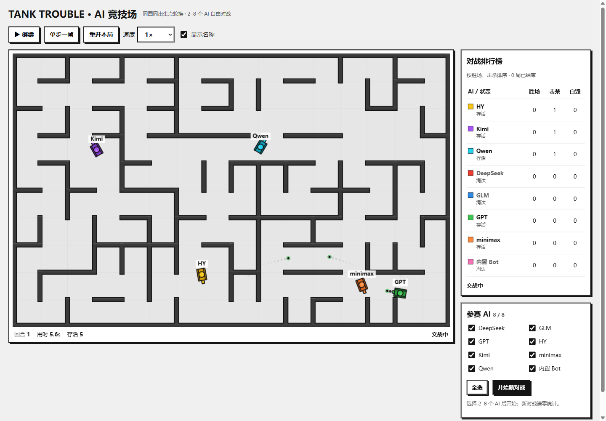
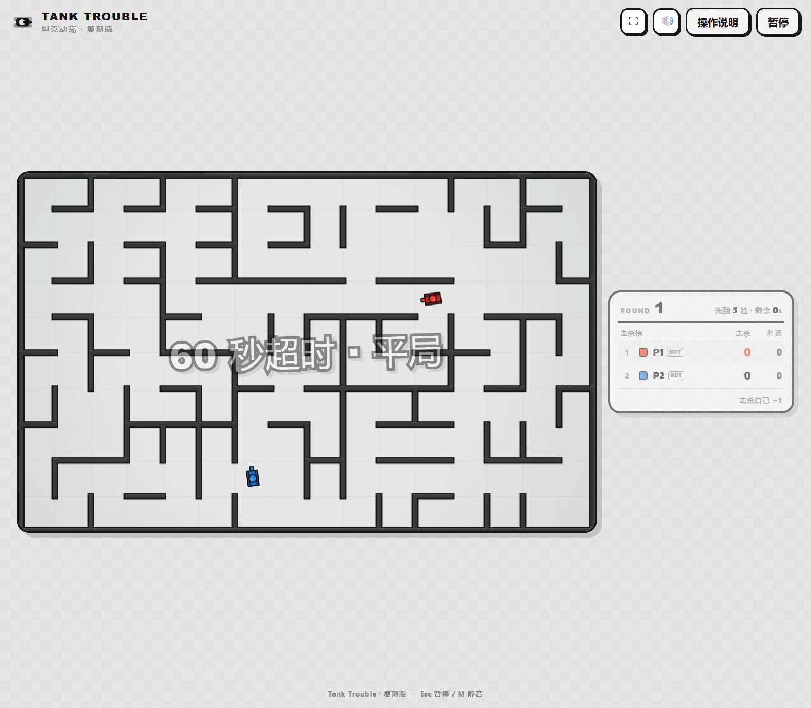
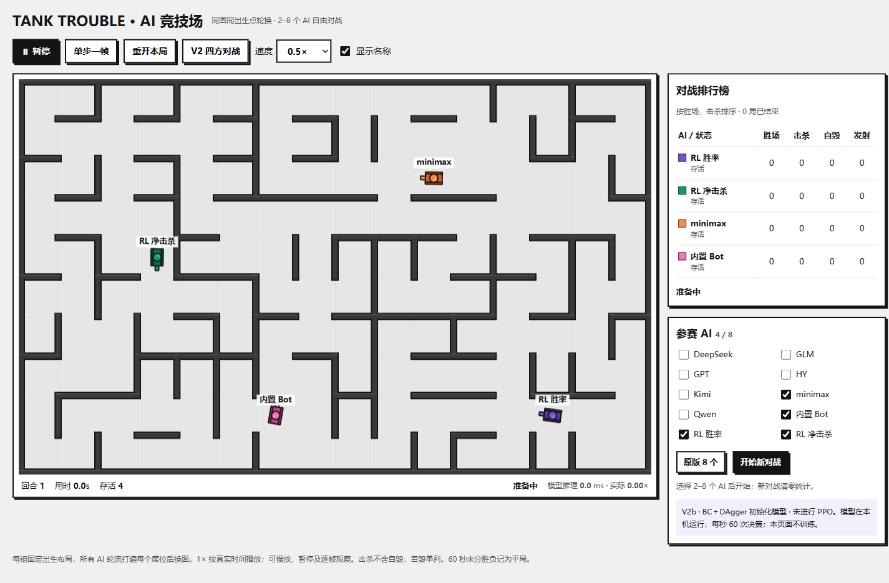
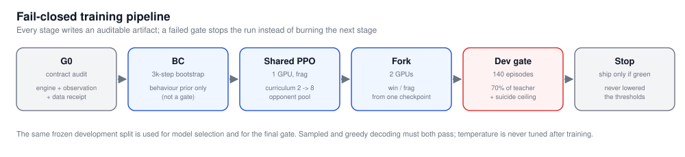
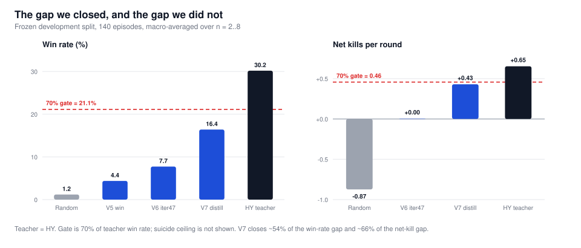
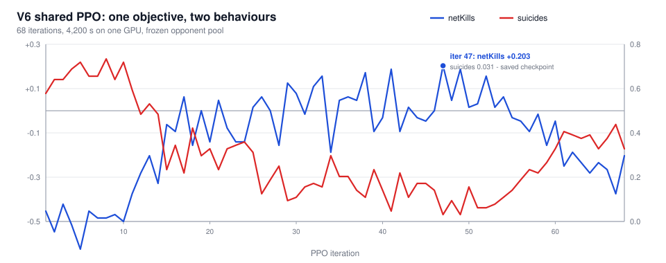
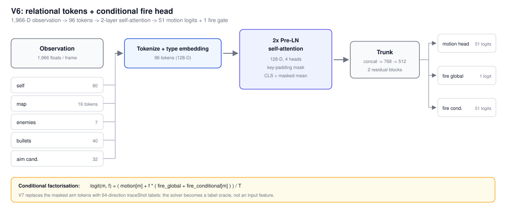

<div align="center">



# Tank Trouble: a playable clone, seven LLM agents, and eight generations of learned policies

**A systems-and-ML research log — from canvas physics and a fairness-audited agent arena to imitation, distillation, PPO, and the negative result at the end.**

<p>


</p>

**[▶ Play in the browser](https://mystic-qaq.github.io/tank-trouble-rl/) · [Watch the agent arena](https://mystic-qaq.github.io/tank-trouble-rl/arena/)**<br>
[中文版](README.zh-CN.md) · [Research notes](docs/) · [Experiment artifacts](research/)

</div>

---

## The short version

This repository started as a browser reimplementation of **Tank Trouble** — a deterministic tank game where one bullet kills, bullets ricochet five times, and the last tank alive wins the round. It became a testbed for a harder question:

> **Can a small, sensor-only neural policy learn to play a ricochet game as well as a hand-written, privileged solver?**

We tried seven training campaigns across eight design iterations: behaviour cloning, DAgger, recurrent pretraining, a factorised PPO objective, a relational attention architecture, and analytic-aim distillation. The best learned policy reached **16.4% win rate** against a **30.2%** teacher on a frozen 140-episode development split. The acceptance gate was **21.1%**. It did not pass, and we did not lower the gate.

That failure is the point of the repository. Every generation is preserved with its data, code, metrics, and post-mortem, so the story is reproducible rather than a highlight reel.

| What we built | Scale |
|---|---|
| Playable game engine + UI, no art assets | ~2.6k lines of vanilla JS, Canvas 2D, WebAudio synthesis |
| Frozen agents written by seven different LLMs | 7 policies + built-in bot, ~17k lines, source-hash manifest |
| Fairness-audited arena | seat rotation, per-round sandbox, write audit, steer audit, 1,680 head-to-head matches |
| Demonstration corpus | 6,000 worlds, 9,319 + 1,200 skill trajectories, 7.61M multi frames, ~80 GB |
| Learned policies | V1–V7 checkpoints, V8 design + partial implementation |
| Best learned result | 16.4% win / +0.43 net kills vs teacher 30.2% / +0.65 |

---

## 1. The game: a deterministic physics toy



The game is deliberately small; in the arena and training harness it is fully deterministic:

- **World**: 1280×800, a 16×10 grid of 80 px cells. Walls are 10 px thick and live on cell boundaries; contiguous segments are merged into long walls.
- **Maps**: recursive division with carved 2×2/2×3 rooms, then random wall removal. Two fixed seeds alternate between rounds, so a match is reproducible but not symmetric.
- **Tanks**: up to 8 per round, 2 human seats plus bots, or pure AI spectator mode. Spawn points are chosen so that no two tanks start with a clear shot at each other.
- **Bullets**: one hit kills, five simultaneous bullets per tank, five ricochets before despawn. Your own ricochet can kill you — this single rule drives most of the strategy.
- **Rounds**: first to 5 wins; 60-second limit; timeout is a draw. The arena and training harness advance a fixed 1/60 s step; the browser loop uses a clamped variable timestep.
- **Presentation**: everything is drawn with Canvas primitives (no sprites), and every sound is synthesized with WebAudio. There is no build step and no network dependency.

The engine doubles as the training environment. The same `js/` files run in the browser, in the arena sandbox, and inside the Node worker farm used by PPO. There is no second, approximate Python physics implementation.

**What this part demonstrates:** front-end architecture, game-loop and deterministic-stepping design, canvas rendering, input/audio, procedural level generation, and a UI that stays readable at 8 tanks.

[Read the engine notes →](docs/01-game-and-engine.md)

---

## 2. Seven agents, one arena

We asked seven different LLMs to write a policy against the same interface, then froze their source and compared them under identical rules.

```js
updateBot(tank, game, dt) -> { drive: -1|0|1, steer: [-1,1], shoot: boolean }
```

The arena loads each policy into an isolated VM context, normalises the return value, and rotates every policy through every spawn seat. **No policy source file is modified by the harness**; even the ESM-only policies are mechanically wrapped into classic scripts for `file://` use, with a byte-level cross-check against the original.

| Agent | Written by | Strategy in one line | 8-player win rate |
|---|---|---:|---:|
| **HY** | HY | Survival-first; only shoot when the ricochet is safe | **33.2%** |
| **GPT Sentinel** | GPT | Aggressive duellist; highest kills per round | 21.2% |
| **GLM** | GLM | Trajectory cache + 72-direction bank shots + evasion | 18.2% |
| **DeepSeek** | DeepSeek | Win-condition first, conservative trading | 15.2% |
| **Qwen** | Qwen | Never self-kill; only high-confidence shots; cover movement | 5.0% |
| **Kimi** | Kimi | Short-horizon ricochet prediction; only simulated hits | — |
| **minimax** | MiniMax | Full bullet-flight simulation before pulling the trigger | — |
| **Built-in bot** | engine | The original `TT.updateBot` baseline | — |

Why the ranking is believable:

- **Seat rotation** — every agent plays every spawn slot on the same map before the map changes.
- **Per-round sandbox** — policies are reloaded each round, so internal caches cannot leak across games.
- **Write audit** — a `Proxy` records every write a policy makes to game/tank/bullet state. All seven policies made **zero** writes.
- **Steer audit** — the harness deliberately does not clamp `steer`; measured `|steer| > 1` was **0.00%** for every agent.
- **Head-to-head** — 28 pairs × 30 rounds × swapped seats = **1,680 matches**.

The most interesting result is that **the format picks the champion**:

- 8-player free-for-all: **HY** wins by surviving (33.2% win, 1.17 kills/round).
- 1v1: **GPT Sentinel** wins (72.1%), with HY third (68.1%).
- By kills: **GPT Sentinel** leads (1.79 kills/round), while HY leads by wins.



> **A measurement trap we had to fix:** minimax's README claimed 95.0% by dividing wins by `matches × 5 × seeds`, assuming every match lasts exactly 5 rounds. A first-to-5 match actually lasts 10–20 rounds. Under the common per-round denominator, the same policy is **26.5%**. The arena exists partly to make such comparisons honest.

[Read the arena and audit notes →](docs/02-agent-arena.md)

---

## 3. Learning to play: eight generations



Every generation followed the same discipline:

1. **G0 contract audit** — engine, observation schema, action space, and a per-file data receipt must match; otherwise stop.
2. **Behaviour prior** — BC is a bootstrap, not a claim of success.
3. **Optimisation** — PPO-like clipped surrogate on the real engine reward, with KL rollback.
4. **Frozen development gate** — 140 episodes, macro-averaged over 2–8 players, compared with the teacher. **Thresholds were never lowered.**

| Version | Main idea | What actually happened |
|---|---|---|
| **V1** | BC on 65k teacher samples, then PPO | 92.5% motion accuracy, **0% fire recall**, 3.6% win. The policy learned to drive, not to shoot. |
| **V2** | DAgger + six micro-skill scenarios | Skills improved sharply (bank shots 38→92%), but fire precision/recall stayed low and the gates failed. PPO never started. |
| **V3** | 4.6M-parameter recurrent pretrain + 3 DAgger rounds | 9.76% win, +0.028 net kills after 70 episodes; PPO stopped for a readiness review. |
| **V4** | 102-class joint action head, 4 GPUs | Fire predictions were **always zero**. Root cause: inverse-probability weights suppressed fire frames 199–1000×, and a toy-fixture test had encoded the wrong invariant. |
| **V5** | Factorised **51 motion + 1 fire** head, direct PPO, curriculum | Throughput 10→17–22 steps/s; win 4.4%, frag net kills **+0.358**, suicides 0.007 in greedy. First policy to pass the suicide ceiling, still below the win gate. |
| **V6** | 96-token relational attention + conditional fire head | Shared PPO reached **+0.203 net kills** / 0.031 suicides at iter 47, but dev win was only **7.7%**. Stopped to rethink the reward. |
| **V7** | Analytic-aim distillation: 64-direction `traceShot` labels | Best learned policy: **16.4% win**, +0.43 net kills, 0.183 suicides, 24.3% draws. Still below the 21.1% gate. |
| **V8** | Sensor-only schema, solver as label oracle, factored 5-D actions, per-opponent GRU | Design + partial implementation; not a completed result. |

### The result that matters



On the frozen development split (140 episodes, macro over n=2..8):

| Policy | Win rate | Net kills | Suicides | Draws |
|---|---:|---:|---:|---:|
| Uniform random (measured) | 1.19% | −0.87 | 0.926 | 10.0% |
| V5 win objective (greedy) | 4.38% | — | 0.096 | — |
| V6 shared iter 47 (greedy) | 7.74% | +0.004 | 0.038 | 22.1% |
| **V7 aim-distilled (greedy)** | **16.41%** | **+0.430** | **0.183** | 24.3% |
| Acceptance gate (70% of teacher) | 21.13% | — | ≤0.153 | — |
| HY teacher | 30.19% | +0.653 | 0.123 | 17.9% |

V7 closed roughly **54% of the win-rate gap** and **66% of the net-kill gap**. That is real progress from a sensor-only policy, but it is not a passing result.

The per-player-count breakdown explains *how* it fails: V7 wins **62.5% of 2-player rounds** (above the teacher's 50%) but collapses to **0% at n=6** and 9.4% at n=8. It learned to duel, not to survive a melee. It also draws more often than the teacher (24.3% vs 17.9%) and wins only 15.1% of decided rounds vs the teacher's 32.2% — a survivable but passive policy.



The V6 curve is the clearest single picture of the problem. `netKills` climbs from −0.5 to +0.2 while suicides fall from 0.7 to 0.03 — then both drift the wrong way in late training, and the saved checkpoint is the local peak at iteration 47, not the final policy.

[Read the full learning log →](docs/03-learning-policies.md)

---

## 4. Architecture: what the network actually sees

V6 keeps the original 1,966-D observation but changes how it is processed:

- **96 tokens**: 16 map tokens, 7 enemy tokens, 40 bullet tokens, 32 aim-candidate tokens, 1 CLS.
- **2-layer Pre-LN self-attention** (128-D, 4 heads) with a padding mask. Unlike V5's three independent pooling heads, bullets, enemies and aim candidates can now interact.
- **Conditional fire head**: `logit(m, f) = (motion[m] + f · (fire_global + fire_conditional[m])) / T`. Each manoeuvre gets its own fire marginal, while a global term keeps the fire gradient from being diluted across 51 motion classes.
- **~2.1M parameters**, smaller than V5's 3.6M because the large flattened map layer is gone.



V7 adds the part that finally moved the needle: instead of asking the network to regress a solver's output, it **distils an analytic aim servo**. For 64 evenly spaced directions around the tank, a `traceShot` call provides three labels — will it hit an enemy, will it hit me, time-to-hit. A separate target provides the exact servo error for the best safe candidate. The solver is a **label oracle**, not an input feature; the inference graph never calls it.

V8 pushes this idea further: observation drops from 1,966 to 608 dimensions, the solver disappears from the input path entirely, actions become **5-D with three independent distributions**, and four auxiliary heads (aim, threat, intent, forward dynamics) are used only during training. It is the design we would run next; it is not claimed as a result.

[Read the architecture notes →](docs/04-architecture.md)

---

## 5. What went wrong (the useful part)

None of these are hypothetical; each is backed by a run, a log, or an ablation in `research/`.

1. **A correct metric can still be gamed.** `netKills = kills − suicides` is exactly the game's score. But "never fire" makes suicides go to zero faster than it makes kills go up. V6's best checkpoint had lower suicides than the teacher (0.031 vs 0.123) and a win rate of 7.7%. The reward was correct; the behaviour it selected was not.
2. **Joint action heads dilute rare events.** A 102-class joint distribution spends almost all of its gradient on navigation. Fire frames are ~0.6% of the data. Factorising into `51 + 1` was necessary before any fire signal could survive.
3. **Importance weighting can silently delete a class.** V4's inverse-probability correction suppressed fire frames by 199–1000×. The contract test used a 5%-fire toy fixture, so it certified the wrong invariant. Real data has ~0.6% fire.
4. **Sparse win rewards teach survival, not aggression.** Survival bonuses and death penalties reliably reduce suicides; they do not teach a policy to create a winning shot. V5's win model stayed at 4.4% after 80 iterations.
5. **Teacher guidance is not a free lunch.** Two A/B runs of KL-to-teacher failed: advantage-weighted guidance blew up KL to 0.21; uniform guidance was rejected by the trust region on every one of 14 iterations.
6. **Evaluation discipline is a feature, not paperwork.** The measured uniform-random policy wins **1.19%**, not the analytic 20% (draws and 8-player dilution matter). Using the wrong baseline turns a 7.7% policy into "below random" and sends the next month in the wrong direction.
7. **Systems problems look like learning problems.** A hung NFS mount, `DataParallel` on a 14 MB model, and CPU simulation (60–77 s per rollout vs 5–11 s per GPU update) all presented as "the model is not learning". Fixing the data path moved throughput ~7× before any model change.

We kept the failed checkpoints and logs. The gate was never relaxed, and no learned policy was deployed over the frozen agents.

---

## 6. Reproduce it

**Play the game** (no build step):

```bash
python -m http.server 8000
# open http://localhost:8000/
```

Or double-click `index.html`. The arena is at `arena/index.html`; its seven frozen policies load from `policy/`.

**Run the arena:**

```bash
node --experimental-vm-modules arena/run.mjs --rounds 208 --seed 20260101 --jobs 8
node arena/regression.mjs
node policy/verify-frozen.mjs
```

**Run the learning tests:**

```bash
python -m pytest -q policy/rl/v4
node --experimental-vm-modules policy/rl/test-env.mjs
node policy/rl/v8/test_traceshot.mjs
```

**Training** expects a frozen demonstration corpus and a G0 data receipt (about 80 GB). The corpus is not shipped; `policy/rl/v8/collect.py` and `policy/rl/v3/collect.py` show how it is generated. The orchestration scripts in `research/v6/` are the actual scripts used for the long run.

[Full reproduction notes →](docs/05-reproduction.md)

---

## 7. Repository map

```text
.
├── index.html, css/, js/        playable game + deterministic engine
├── arena/                       agent harness, fairness audits, spectator UI
│   └── models/                  ONNX checkpoints for browser-side inference
├── policy/                      seven frozen LLM policies + built-in baseline
│   └── rl/                      learning code: v1 ... v8
├── research/                    curated run artifacts (scripts, metrics, logs)
├── docs/                        long-form notes and post-mortems
└── assets/                      screenshots and generated figures
```

Start with:

- [`docs/01-game-and-engine.md`](docs/01-game-and-engine.md) — mechanics, map generation, determinism.
- [`docs/02-agent-arena.md`](docs/02-agent-arena.md) — seven agents, fairness, audits, metric traps.
- [`docs/03-learning-policies.md`](docs/03-learning-policies.md) — V1–V8, including every failure.
- [`docs/04-architecture.md`](docs/04-architecture.md) — V6/V7/V8 network and observation design.
- [`docs/05-reproduction.md`](docs/05-reproduction.md) — environment, data, commands, artifact map.
- [`research/README.md`](research/README.md) — experiment index and provenance.

---

## 8. Scope and honesty

- This is a **research snapshot**, not a production game or a state-of-the-art agent.
- The headline comparison is a **140-episode development split**, not the full 2,240-episode acceptance gate. Confidence intervals at this sample size are wide; treat small differences as noise.
- Most comparisons are **single training seeds**. The negative result is robust; the exact ordering of weak policies is not.
- Arena results were measured on the **2026-11-06 engine snapshot**. Rerun `arena/run.mjs` if you need current numbers; the historical reports are kept for provenance.
- The published tree is a documentation snapshot. `source_digest` values quoted in logs refer to the original training snapshot; any edit to the hashed source tree requires a fresh G0, by design.
- The 80 GB demonstration corpus is not in the repository. `research/` contains the scripts, receipts, and metrics needed to rebuild it.

---

## 9. Credits

- **Tank Trouble** is the original Flash game by its creators. This is an unaffiliated fan reimplementation for research and education; no original art or audio assets are used.
- The seven policies were generated by different LLMs under a shared interface, then frozen. They are included as research artifacts, not as endorsements of any model.
- `arena/vendor/onnxruntime` is a redistribution of ONNX Runtime Web; see its bundled license.
- Everything in `js/`, `arena/`, `policy/rl/`, `docs/`, and `research/` is original code or documentation unless noted.

MIT licensed. See [LICENSE](LICENSE) and [NOTICE](NOTICE).
