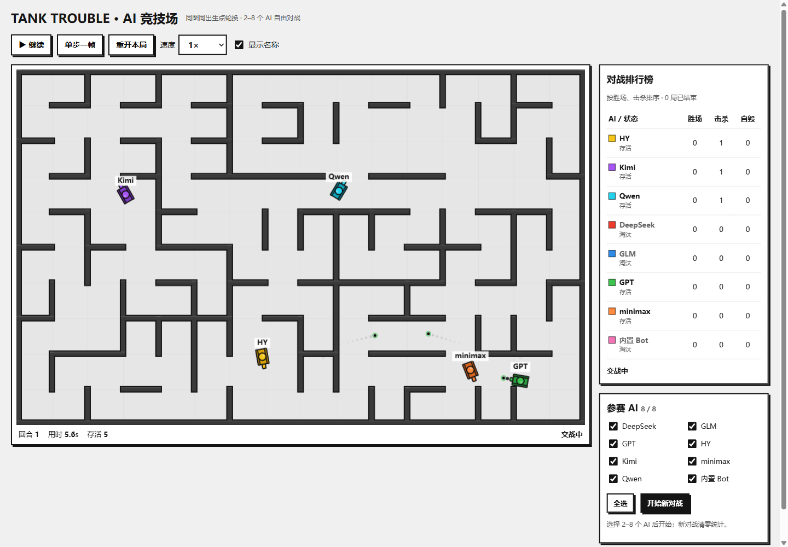
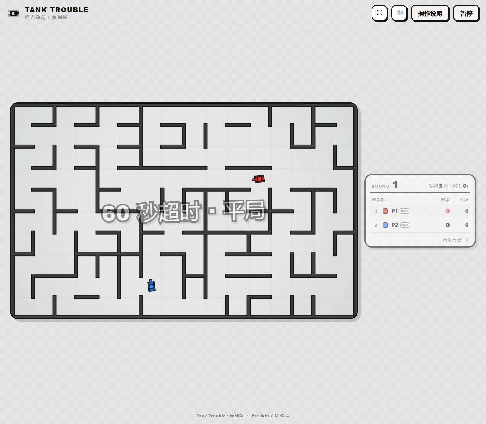
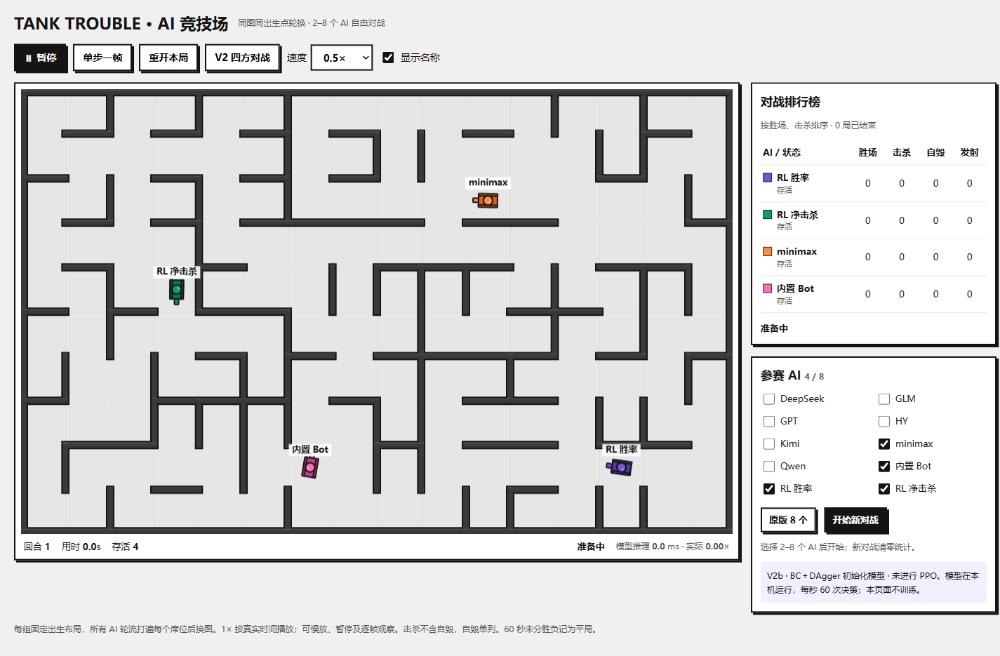
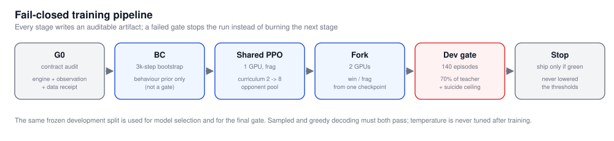
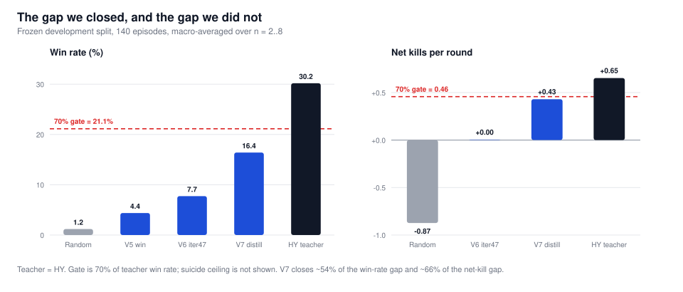
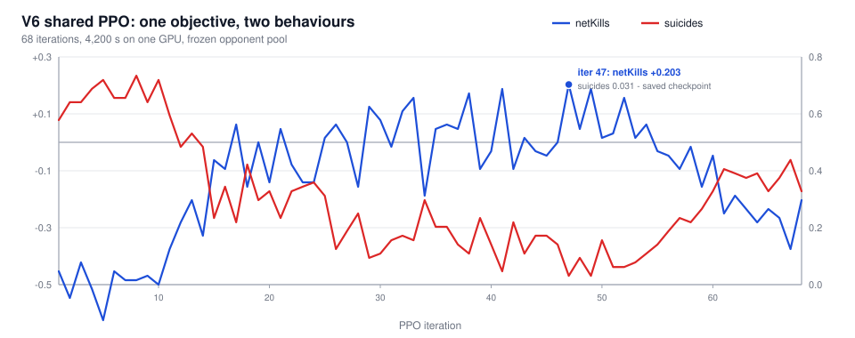
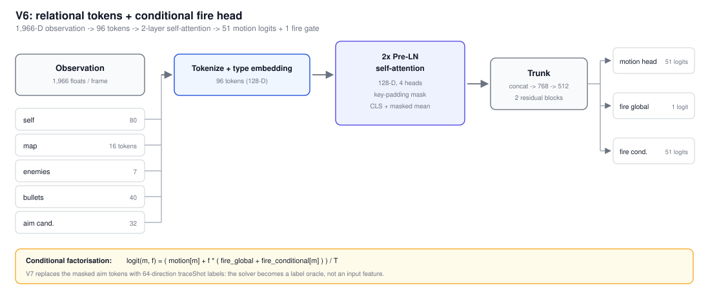

<div align="center">



# Tank Trouble：一个可玩的复刻游戏、七个 LLM 智能体，与八代学习型策略

**一份系统与机器学习的研究日志：从 Canvas 物理、公平性审计的 Agent 竞技场，到模仿学习、蒸馏、PPO，以及最后的负结果。**

<p>


</p>

[English](README.md) · [研究笔记](docs/) · [实验产物](research/)

</div>

---

## 一句话总结

这个仓库最初只是用浏览器复刻 **Tank Trouble**：一个确定性物理、一枪毙命、子弹反弹五次、最后存活者获胜的坦克游戏。后来它变成了一个更难问题的试验场：

> **一个小型、只依赖传感器输入的神经网络策略，能不能学会像手写的、拥有特权信息的求解器一样打反弹球？**

我们试了八代设计、七套训练配方：行为克隆、DAgger、循环预训练、分解式 PPO、关系型注意力架构、解析瞄准蒸馏。最好的一代在冻结的 140 局开发集上拿到 **16.4% 胜率**，教师是 **30.2%**，验收线是 **21.1%**。它没有通过，我们也没有降低门槛。

**这个失败本身就是仓库的价值。** 每一代的数据、代码、指标和复盘都保留下来，所以这是一个可复现的研究故事，而不是一份只挑好看结果的简历。

| 我们做了什么 | 规模 |
|---|---|
| 可玩的游戏引擎 + UI，零美术素材 | 约 2.6k 行原生 JS，Canvas 2D，WebAudio 合成音效 |
| 七个不同 LLM 写出的冻结策略 | 7 份策略 + 内置 Bot，约 17k 行，带源码哈希清单 |
| 公平性审计竞技场 | 席位轮转、逐局沙箱、写入审计、转向审计、1680 场单挑 |
| 示范数据集 | 6000 个世界、9319 条多智能体轨迹 + 1200 条技能轨迹、761 万帧、约 80 GB |
| 学习型策略 | V1–V7 检查点，V8 设计与部分实现 |
| 最好的学习结果 | 16.4% 胜率 / +0.43 净击杀；教师 30.2% / +0.65 |


---

## 1. 游戏：一个确定性的物理玩具



游戏刻意做得很小；在竞技场与训练环境中，它是完全确定性的：

- **世界**：1280×800，16×10 个 80 px 单元格。墙厚 10 px，落在单元格边界上；连续墙段会合并成长墙。
- **地图**：递归分割 + 挖出 2×2/2×3 房间 + 随机拆墙。两张固定种子地图按回合交替，所以一局可复现，但地图不对称。
- **坦克**：单局最多 8 辆；支持 2 人同屏 + 电脑对手，也支持纯 AI 观战。出生点会保证任意两辆坦克开局没有直接对穿射击线。
- **子弹**：一枪毙命，每车最多 5 发在场，反弹 5 次后消失。**自己的反弹子弹也能打死自己**——这一条规则决定了大部分策略。
- **回合**：先到 5 胜；60 秒上限，超时平局。竞技场与训练按固定 1/60 秒步进；浏览器主循环使用带钳制的可变时间步。
- **表现层**：全部用 Canvas 图元绘制（无贴图），所有音效由 WebAudio 合成。无构建步骤、无联网依赖。

引擎同时就是训练环境：浏览器、竞技场沙箱、PPO 的 Node worker 跑的是同一份 `js/`，不存在第二套近似的 Python 物理。

**这一部分展示的是：** 前端架构、游戏循环与确定性步进、Canvas 渲染、输入与音频、程序化关卡生成，以及 8 辆坦克同屏仍然可读的 UI。

[引擎与地图生成细节 →](docs/01-game-and-engine.md)

---

## 2. 七个智能体，一个竞技场

我们让七个不同的 LLM 针对同一个接口写策略，然后冻结源码，在完全相同的规则下比较。

```js
updateBot(tank, game, dt) -> { drive: -1|0|1, steer: [-1,1], shoot: boolean }
```

竞技场把每份策略装进独立的 VM 上下文，归一化返回值，并让每份策略轮流坐遍每个出生席位。**harness 不修改任何策略源码**；连只支持 ESM 的策略也只是机械包装成 classic script 供 `file://` 使用，并与原始代码做逐字节交叉校验。

| 智能体 | 由谁写出 | 一句话打法 | 8 人混战胜率 |
|---|---|---:|---:|
| **HY** | HY | 生存第一，只在反弹安全时开火 | **33.2%** |
| **GPT Sentinel** | GPT | 激进单挑型，每局击杀最高 | 21.2% |
| **GLM** | GLM | 弹道缓存 + 72 向反弹猎杀 + 主动规避 | 18.2% |
| **DeepSeek** | DeepSeek | 以回合胜场为目标，保守换血 | 15.2% |
| **Qwen** | Qwen | 绝不打死自己，只在必杀时开火，掩体走位 | 5.0% |
| **Kimi** | Kimi | 短时域反弹预测，只打模拟命中的枪 | — |
| **minimax** | MiniMax | 开火前把整条弹道跑一遍模拟 | — |
| **内置 Bot** | 引擎 | 原始 `TT.updateBot` 基线 | — |

为什么这个排名可信：

- **席位轮转**：同一张地图上，每个智能体都要打遍每个出生位，才换图。
- **逐局沙箱**：每局重新加载策略，内部缓存不会跨局串味。
- **写入审计**：用 `Proxy` 记录策略对 game/tank/bullet 的每一次写操作，七份策略全部 **0 次写入**。
- **转向审计**：harness 故意不截断 `steer`；实测所有智能体 `|steer| > 1` 的占比都是 **0.00%**。
- **逐对单挑**：28 对 × 30 局 × 互换座位 = **1680 场**。

最有趣的结果是：**赛制决定冠军。**

- 8 人混战：**HY** 靠活到最后获胜（33.2% 胜率，1.17 击杀/局）。
- 1v1：**GPT Sentinel** 第一（72.1%），HY 只排第三（68.1%）。
- 按击杀：**GPT Sentinel** 第一（1.79 击杀/局），HY 靠胜场第一。



> **我们踩过的一个度量陷阱：** minimax 的 README 声称 95.0%，分母是 `场数 × 5 × 种子数`，假设每场正好 5 回合。但「先到 5 胜」实际会打 10–20 回合。换成统一的每回合分母后，同一个策略是 **26.5%**。竞技场存在的意义之一，就是让这种比较变得诚实。

[竞技场、公平性与审计细节 →](docs/02-agent-arena.md)

---

## 3. 学习打游戏：八代尝试



每一代都遵守同一套纪律：

1. **G0 契约审计**：引擎、观测 schema、动作空间、逐文件数据收据必须一致，否则停止。
2. **行为先验**：BC 只是初始化，不当作成功。
3. **优化**：在真实引擎奖励上做 PPO-like clipped surrogate，带 KL 回滚。
4. **冻结开发集闸门**：140 局，按 2–8 人宏平均，与教师比较；**门槛从未降低**。

| 版本 | 核心想法 | 实际发生了什么 |
|---|---|---|
| **V1** | 6.5 万条教师样本做 BC，再接 PPO | 移动准确率 92.5%，**开火召回 0%**，胜率 3.6%。学会了开车，没学会开枪。 |
| **V2** | DAgger + 六个微技能场景 | 技能明显提升（反弹射击 38→92%），但开火精度/召回仍低，闸门未过，PPO 没有启动。 |
| **V3** | 460 万参数循环预训练 + 三轮 DAgger | 70 局验证胜率 9.76%，净击杀 +0.028；因准备度审查停止 PPO。 |
| **V4** | 102 类联合动作头，4 卡 | 开火预测**恒为 0**。根因是逆概率权重把开火帧压制了 199–1000 倍，而玩具测试把错误的不变量锁成了契约。 |
| **V5** | **51 运动 + 1 开火**分解头，直接 PPO，课程学习 | 吞吐 10→17–22 步/秒；胜率 4.4%，净击杀 **+0.358**，greedy 自杀 0.007。首次通过自杀率控制，仍未过胜率门。 |
| **V6** | 96-token 关系型注意力 + 条件开火头 | 共享 PPO 在第 47 轮达到 **+0.203 净击杀** / 0.031 自杀，但 dev 胜率只有 **7.7%**。为重新设计奖励而停止。 |
| **V7** | 解析瞄准蒸馏：64 方向 `traceShot` 标签 | 最好的学习型策略：**16.4% 胜率**、+0.43 净击杀、0.183 自杀、24.3% 平局。仍低于 21.1% 门槛。 |
| **V8** | 纯传感器 schema、求解器只做标签、5 维分解动作、按对手分槽 GRU | 设计与部分实现；不是一个已完成的结果。 |

### 最重要的结果



冻结开发集（140 局，按 n=2..8 宏平均）：

| 策略 | 胜率 | 净击杀 | 自杀率 | 平局率 |
|---|---:|---:|---:|---:|
| 均匀随机（实测） | 1.19% | −0.87 | 0.926 | 10.0% |
| V5 胜率目标（greedy） | 4.38% | — | 0.096 | — |
| V6 共享 iter47（greedy） | 7.74% | +0.004 | 0.038 | 22.1% |
| **V7 瞄准蒸馏（greedy）** | **16.41%** | **+0.430** | **0.183** | 24.3% |
| 验收线（教师的 70%） | 21.13% | — | ≤0.153 | — |
| HY 教师 | 30.19% | +0.653 | 0.123 | 17.9% |

V7 追回了约 **54% 的胜率差距**、**66% 的净击杀差距**。对一个只依赖传感器输入的小网络来说，这是真实的进步，但不是一个通过的结果。

按人数拆开看，能看出它**怎么**失败：V7 在 **2 人局赢 62.5%**（高于教师的 50%），到 6 人局跌到 **0%**，8 人局 9.4%。它学会了单挑，没学会混战。它的平局率也比教师高（24.3% vs 17.9%），在分出胜负的局里只赢 15.1%（教师 32.2%）——能活，但很被动。



V6 这张图是问题最直观的一张：`netKills` 从 −0.5 爬到 +0.2，自杀率从 0.7 降到 0.03，然后后段双双走坏；保存下来的是第 47 轮的局部峰值，而不是最后一轮。

[完整学习日志 →](docs/03-learning-policies.md)

---

## 4. 架构：网络到底看到了什么

V6 保留原来的 1966 维观测，但改变了处理方式：

- **96 个 token**：16 个地图 token、7 个敌人、40 发子弹、32 个瞄准候选、1 个 CLS。
- **2 层 Pre-LN self-attention**（128 维、4 头、padding mask）。V5 是三组独立的单 query 池化，子弹、敌人、瞄准候选之间没有任何交互；V6 让它们可以互相关注。
- **条件开火头**：`logit(m, f) = (motion[m] + f · (fire_global + fire_conditional[m])) / T`。每个机动有独立的开火边际，同时保留全局项，避免开火梯度被 51 个运动类稀释。
- **约 210 万参数**，比 V5 的 360 万更小，因为删掉了展平地图的大线性层。



V7 加上了真正让指标动起来的部分：不再让网络回归求解器的输出，而是**蒸馏一个解析瞄准伺服**。围绕坦克取 64 个等间隔方向，用 `traceShot` 给每个方向打三个标签——会不会命中敌人、会不会打到自己、多久命中；再用精确候选给出最佳安全方向的伺服误差。求解器在这里是**标签预言机**，不是输入特征；推理图里一次都不会调用它。

V8 把这个想法推得更远：观测从 1966 维降到 608 维，求解器彻底退出输入路径，动作变成 **5 维、三个独立分布**，并加四个只在训练期存在的辅助头（瞄准、威胁、对手意图、前向动力学）。这是我们下一步会跑的方案，不是已经拿到的结果。

[架构与观测设计细节 →](docs/04-architecture.md)

---

## 5. 哪里出了问题（最有价值的部分）

下面每一条都不是猜测，背后都有一次运行、一份日志或一次消融，产物在 `research/`。

1. **正确的指标仍然可以被钻空子。** `netKills = kills − suicides` 就是游戏的真实得分，但「不开枪」让自杀率降得比击杀快得多。V6 最好的检查点自杀率比教师还低（0.031 vs 0.123），胜率只有 7.7%。奖励是对的，被选出来的行为不是。
2. **联合动作头会稀释稀有事件。** 102 类联合分布把绝大部分梯度花在导航上，开火帧只占约 0.6%。不分解成 `51 + 1`，开火信号根本活不下来。
3. **重要性权重可以悄悄删掉一个类。** V4 的逆概率校正把开火帧压制了 199–1000 倍；契约测试用的是 5% 开火的玩具数据，所以它认证了一个错误的不变量。真实数据只有约 0.6%。
4. **稀疏胜率奖励教的是生存，不是进攻。** 生存奖励和死亡惩罚能可靠地降低自杀，但教不会「怎么创造制胜一枪」。V5 的胜率模型跑了 80 轮还停在 4.4%。
5. **教师引导不是免费的午餐。** 两次 KL-to-teacher 的 A/B 都失败：优势加权把 KL 冲到 0.21 后崩溃；均匀权重在 14 轮里每一步都被信任域回滚。
6. **评估纪律是功能，不是流程负担。** 实测均匀随机策略胜率是 **1.19%**，不是解析假设的 20%（平局和 8 人稀释都会影响）。用错基线，会把一个 7.7% 的策略误判成「不如随机」，然后让下一步走错方向。
7. **系统问题看起来像学习问题。** NFS 挂死、14 MB 模型上 `DataParallel`、CPU 仿真每轮 60–77 秒而 GPU 更新只要 5–11 秒——全都表现为「模型学不动」。在任何模型改动之前，先把数据路径修好，吞吐就提升了约 7 倍。

失败的检查点和日志都留着。门槛没有放宽，也没有任何学习型策略被部署去替换冻结的智能体。

---

## 6. 复现

**玩游戏**（无构建步骤）：

```bash
python -m http.server 8000
# 打开 http://localhost:8000/
```

也可以直接双击 `index.html`。竞技场在 `arena/index.html`，七份冻结策略从 `policy/` 加载。

**跑竞技场：**

```bash
node --experimental-vm-modules arena/run.mjs --rounds 208 --seed 20260101 --jobs 8
node arena/regression.mjs
node policy/verify-frozen.mjs
```

**跑学习相关测试：**

```bash
python -m pytest -q policy/rl/v4
node --experimental-vm-modules policy/rl/test-env.mjs
node policy/rl/v8/test_traceshot.mjs
```

**训练**需要冻结的示范语料和 G0 数据收据（约 80 GB）。语料不随仓库发布；`policy/rl/v8/collect.py` 与 `policy/rl/v3/collect.py` 展示了生成方式。`research/v6/` 里是长时间运行实际使用的编排脚本。

[完整复现说明 →](docs/05-reproduction.md)

---

## 7. 仓库地图

```text
.
├── index.html, css/, js/        可玩游戏 + 确定性引擎
├── arena/                       Agent harness、公平性审计、观战 UI
│   └── models/                  浏览器推理用的 ONNX 检查点
├── policy/                      七份冻结的 LLM 策略 + 内置基线
│   └── rl/                      学习代码：v1 ... v8
├── research/                    精选运行产物（脚本、指标、日志）
├── docs/                        长文笔记与复盘
└── assets/                      截图与生成的图表
```

建议阅读顺序：

- [`docs/01-game-and-engine.md`](docs/01-game-and-engine.md) — 机制、地图生成、确定性。
- [`docs/02-agent-arena.md`](docs/02-agent-arena.md) — 七个智能体、公平性、审计、度量陷阱。
- [`docs/03-learning-policies.md`](docs/03-learning-policies.md) — V1–V8，包括每一次失败。
- [`docs/04-architecture.md`](docs/04-architecture.md) — V6/V7/V8 的网络与观测设计。
- [`docs/05-reproduction.md`](docs/05-reproduction.md) — 环境、数据、命令、产物地图。
- [`research/README.md`](research/README.md) — 实验索引与证据来源。

---

## 8. 范围与诚实声明

- 这是一个**研究快照**，不是生产级游戏，也不是 SOTA 智能体。
- 主对比是 **140 局开发集**，不是完整的 2240 局正式验收。这个样本量下置信区间很宽，小差距应当视为噪声。
- 多数对比只用了**单个训练种子**。负结果本身是稳健的；弱策略之间的精确排序不是。
- 竞技场数据来自 **2026-11-06 的引擎快照**。需要当前数字请重跑 `arena/run.mjs`；历史报告保留是为了可追溯。
- 发布树是文档快照。日志中引用的 `source_digest` 对应原始训练快照；对哈希范围内的源码做任何修改都必须重跑 G0，这是设计约束。
- 80 GB 示范语料不在仓库里。`research/` 保留了重建它所需的脚本、收据和指标。

---

## 9. 致谢与许可

- **Tank Trouble** 是原 Flash 游戏创作者的作品。这里是出于研究与学习目的的非官方复刻，不使用原作的美术或音频素材。
- 七份策略由不同 LLM 在统一接口下生成，随后冻结；它们作为研究产物收录，不代表对任何模型的背书。
- `arena/vendor/onnxruntime` 是 ONNX Runtime Web 的再分发，许可证见其目录内文件。
- 除特别注明外，`js/`、`arena/`、`policy/rl/`、`docs/`、`research/` 中的代码与文档均为原创。

MIT 许可。见 [LICENSE](LICENSE) 与 [NOTICE](NOTICE)。
